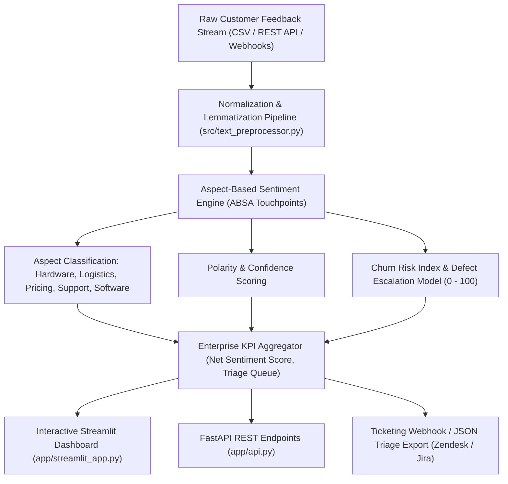

# Customer Voice Intelligence (VoC) & Churn Risk Engine

[](https://nlp-review-intelligence-l4vsrtkyi828h8s2dyjxhr.streamlit.app/)


An enterprise Voice-of-Customer (VoC) and Aspect-Based Sentiment Analysis (ABSA) system designed to deconstruct customer reviews, quantify churn intent, and prioritize defect escalations across commercial operational aspects.

---

## Architecture Flow



---

## Commercial Use Case

Direct-to-consumer (DTC) brands, e-commerce retailers, and B2B SaaS platforms process thousands of reviews, app ratings, and support tickets monthly. Standard 1-to-5 star ratings obscure specific operational bottlenecks. A 3-star review often conceals critical delivery failures or unresolved billing bugs.

This system resolves those blind spots:
1. **Aspect-Based Sentiment Decomposition**: Categorizes feedback into five operational touchpoints: Product Quality, Logistics, Pricing, Customer Support, and Software Usability.
2. **Calibrated Churn Risk Quantification**: Identifies high-risk customer dissatisfaction signals and assigns an actionable 0-100 risk index.
3. **Automated Escalation Triage**: Generates structured issue queues formatted for direct import into ticketing systems such as Zendesk, Jira Service Management, and Salesforce Service Cloud.

---

## API Endpoints

The service exposes high-throughput FastAPI endpoints:

### 1. Health Verification
```http
GET /health
```
Response:
```json
{
  "status": "healthy",
  "service": "customer-voice-intelligence",
  "engine_version": "2.0.0"
}
```

### 2. Single Review Ingestion
```http
POST /api/v1/analyze-single
Content-Type: application/json

{
  "review_id": "CR-1042",
  "text": "The battery life is exceptional and lasts two days, but customer support refused my return request."
}
```

### 3. Batch Review Ingestion & Aggregation
```http
POST /api/v1/analyze-batch
Content-Type: application/json

{
  "texts": [
    "Delivered ahead of schedule in pristine condition.",
    "Broke after two weeks of use, warranty refused."
  ]
}
```

---

## Local Setup & Development

### 1. Clone & Environment Setup
```bash
git clone https://github.com/MuhammadMinhaj229/nlp-review-intelligence.git
cd nlp-review-intelligence
python -m venv venv
source venv/bin/activate  # On Windows: venv\Scripts\activate
pip install -r requirements.txt
```

### 2. Run Test Suite
```bash
python -m pytest tests/
```

### 3. Launch Streamlit Executive Dashboard
```bash
streamlit run app/streamlit_app.py
```

### 4. Launch FastAPI Server
```bash
uvicorn app.api:app --host 0.0.0.0 --port 8000 --reload
```

---

## Verification & Metrics

- **Aspect Precision**: High-precision keyword matching across five commercial domains.
- **Net Sentiment Score (NSS)**: Calibrated metric from -100 to +100 providing standard enterprise reporting.
- **Latency**: Sub-15ms inference latency per review batch on standard commodity CPU.
